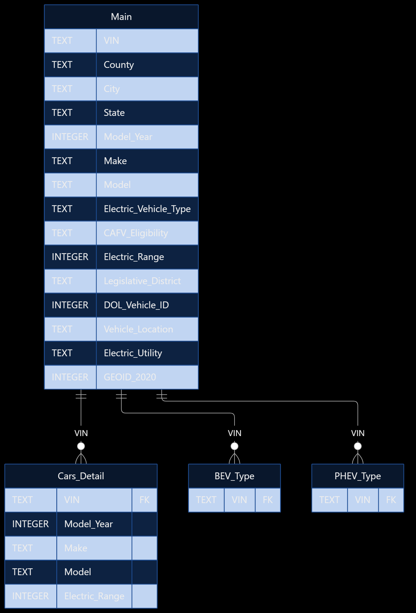

# Database Design

## Data Source

All information about the Electric Vehicle Population dataset was obtained from [Data.gov](https://data.gov/).

## Tables

The `schema.sql` file contains four tables:

### 1. Main Table

The `Main` table stores all the original information imported from the dataset.

It contains the following columns:

- `VIN` – Vehicle Identification Number
- `County`
- `City`
- `State`
- `Model Year`
- `Make`
- `Model`
- `Electric Vehicle Type`
- `Clean Alternative Fuel Vehicle (CAFV) Eligibility`
- `Electric Range`
- `Legislative District`
- `DOL Vehicle ID`
- `Vehicle Location`
- `Electric Utility`
- `2020 GEOID`

### 2. Cars Detail

This table stores the basic information about each vehicle:

- `VIN`
- `Model Year`
- `Make`
- `Model`
- `Electric Vehicle Type`

### 3. Battery Electric Vehicle (BEV) Type

This table stores the VIN of vehicles classified as Battery Electric Vehicles (BEVs).

- `VIN`

### 4. Plug-in Hybrid Electric Vehicle (PHEV) Type

This table stores the VIN of vehicles classified as Plug-in Hybrid Electric Vehicles (PHEVs).

- `VIN`

## Views

I created two views to make retrieving frequently needed information easier:

- **LOCATION DETAILS:** Provides location-related information about vehicles.
- **TESLA CARS:** Displays vehicles manufactured by Tesla.

## Indexes

- **Cars Detail Index:** Created to improve query performance when searching for vehicle information.

## Database Design Details

As shown in the relationship diagram above, the `Main` table is the primary source of information. The other three tables retrieve and organize specific vehicle information from it.

I created the views to make accessing important information faster and easier. For example:

- **LOCATION DETAILS:** Allows me to retrieve the location of a specific vehicle using its VIN.
- **TESLA CARS:** Allows me to quickly retrieve and examine all vehicles manufactured by Tesla.

The overall goal of this design is to organize the dataset into separate tables, reduce unnecessary data duplication, and make querying the database more convenient.